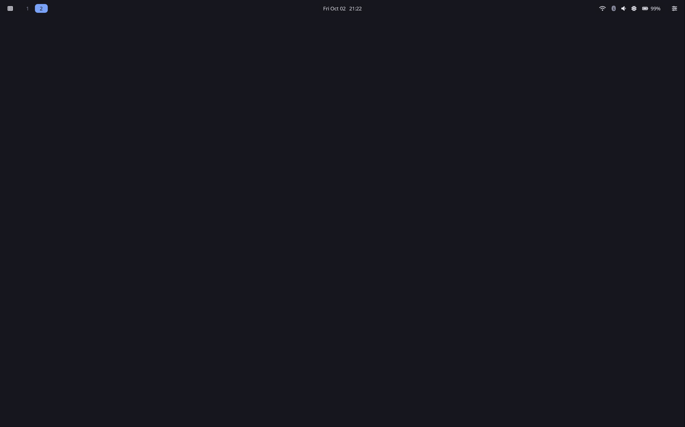

# Lean Sway for Apple Silicon Macs

Sway dotfiles for M-series Macs running [Fedora Asahi Remix](https://asahilinux.org/fedora/),
built to use as little memory as possible while still feeling like a
finished desktop: a top bar where every icon has its own drop-down (with a
GNOME-style panel for volume, brightness, battery and power mode),
GNOME-style volume and brightness pop-ups, an app launcher, notifications, a
lock screen, screenshots and a wallpaper picker.
Command and Control are swapped, so Cmd+C and Cmd+V work like on macOS.

<!-- Add a screenshot: press Ctrl+Cmd+Shift+S, copy the file from
     ~/Pictures/Screenshots into this repo as screenshot.png, and
     uncomment the line below. -->
<!--  -->

## Why

On an 8 GB Mac every gigabyte matters. Measured on an M1 with 8 GB, idle
right after logging in:

<!-- TODO: fresh boot, log in, wait a minute, run `free -h`, and put the
     "used" number in the "This setup" row -->
| Desktop | RAM used at idle |
|---|---|
| GNOME (Fedora Asahi Remix default) | 2.73 GB |
| Stock sway | 1.07 GB |
| This setup | — |

Most of the savings come from not running things until you need them:

| Always running | Starts only when you use it |
|---|---|
| sway, swaybg (wallpaper) | fuzzel (launcher, Wi-Fi / Bluetooth / sound pickers, shortcut list) |
| waybar (top bar and its drop-downs) | foot (terminal) |
| mako (notifications and the volume / brightness pop-up) | pavucontrol, blueman, nm-connection-editor (full settings windows) |
| swayidle + a small script (screen off, lock, auto-sleep) | swaylock (lock screen) |
| | the quick settings panel: sliders, battery, power mode (about 45 MB, only while open) |
| lxpolkit (password prompts) | grim + slurp (screenshots) |

Choices made to keep it small:

- **Mako for notifications** instead of SwayNotificationCenter, which pulls in
  GTK4 and libadwaita.
- **The drop-downs are Waybar's own built-in menus**, so there's no separate
  panel process sitting in memory. Picking a Wi-Fi network, Bluetooth device
  or sound output opens a fuzzel list that closes as soon as you choose.
- **The quick settings panel only exists while it's open.** Clicking the
  volume, brightness or battery icon starts it, and closing it frees its
  memory again.
- **The volume / brightness pop-up is a mako notification** that replaces
  itself, instead of a separate on-screen-display daemon.
- **No tray applets** (nm-applet, blueman-applet). Full settings windows only
  start when you ask for them, and close when you're done.
- **Optional greetd + tuigreet login screen** instead of GDM, which runs a
  whole GNOME Shell just to show the login screen.

Two Asahi notes when comparing numbers: Asahi uses 16K memory pages, so the
same programs read a bit higher than on an x86 laptop, and Fedora enables
zram swap by default, so 8 GB stretches further than it looks.

## Requirements

- A Mac that [Fedora Asahi Remix](https://asahilinux.org/fedora/) supports
- Fedora Asahi Remix installed (any desktop; GNOME is fine, it stays installed
  and you can still pick it at login)

The installer uses `dnf`. On another distro, install the packages listed at
the top of `install.sh` yourself and copy the `config/` folders into
`~/.config/`.

## Install

```
git clone https://github.com/YOUR-NAME/YOUR-REPO.git
cd YOUR-REPO
./install.sh
```

Then log out, pick **Sway** at the login screen, and log in.

| Command | What it does |
|---|---|
| `./install.sh` | Installs the packages, then copies the configs |
| `./install.sh --no-packages` | Copies the configs only. Use this to update after the packages are already installed |
| `./install.sh --greetd` | Also replaces GDM with the greetd + tuigreet login screen (takes effect after a reboot) |

Flags can be combined, e.g. `./install.sh --no-packages --greetd`.

Your existing configs are backed up to `~/.config/<name>.bak-<date>` before
anything is copied, and other files in those folders are left alone.
`--greetd` also backs up `/etc/greetd/config.toml`, and prints how to switch
back to GDM if the new login screen doesn't come up.

## Keyboard

**Command and Control are swapped.** The **Control** key is sway's Mod key
for window shortcuts, and **Command** acts like Ctrl does on other
computers: Cmd+C copies, Cmd+V pastes, Cmd+T opens a tab, Cmd+Q quits.
Key names below are the printed keys on the Mac keyboard.

Press **Ctrl+?** (Ctrl+Shift+/) at any time for a searchable list of every
shortcut.

| Keys | Action |
|---|---|
| Ctrl+? | Shortcut list (type to search, Esc to close) |
| Ctrl+D or Ctrl+Space | App launcher |
| Ctrl+Enter | Terminal |
| Ctrl+Shift+Q | Close window |
| Ctrl+Shift+E | Power menu |
| Ctrl+Cmd+Q | Lock (same as macOS) |
| Ctrl+Shift+C | Reload sway and the bar |
| Cmd+C / X / V / Z | Copy / cut / paste / undo in apps |
| Cmd+Shift+C / V | Copy / paste in the terminal (Cmd+C stops a command there) |
| Ctrl+arrows or H/J/K/L | Move focus (add Shift to move the window) |
| Ctrl+1…0 / Ctrl+Shift+1…0 | Go to / send window to workspace |
| Ctrl+Tab | Previous workspace |
| Ctrl+F | Fullscreen |
| Ctrl+Shift+Space | Float / tile window |
| Ctrl+drag | Move a floating window (right-drag resizes) |
| Ctrl+R | Resize mode (arrows, Esc to leave) |
| Ctrl+B / Ctrl+V | Next window opens beside / below |
| Ctrl+W / Ctrl+S / Ctrl+E | Tabbed / stacked / split layout |
| Ctrl+Shift+S | Screenshot an area (Ctrl+Cmd+Shift+S: whole screen) |
| Ctrl+Shift+W | Change wallpaper |
| Ctrl+N | Do Not Disturb on/off |

The top-row brightness, keyboard light, media and volume keys work as on
macOS. Screenshots are saved to `~/Pictures/Screenshots` and copied to the
clipboard.

Prefer the normal layout? Delete the `xkb_options` line in
`~/.config/sway/config` and reload. The Mod key then moves to Command.

## The bar

| Where | What | Click | Right-click / scroll |
|---|---|---|---|
| Far left | Apps grid | Open the launcher | |
| Left | Workspaces | Switch | |
| Middle | Clock | Recent notifications (hover for a calendar) | Scroll: change the calendar month. Right-click: year view |
| Middle | Muted bell | Only shows during Do Not Disturb; click to end it | |
| Right | Wi-Fi | Menu: choose a network, Wi-Fi on/off, network settings | |
| Right | Bluetooth | Menu: connect a device, Bluetooth on/off, pair a new device | Right-click: Bluetooth on/off |
| Right | Volume | Quick settings panel (see below) | Scroll: volume. Right-click: mute |
| Right | Sun | The same panel | Scroll: brightness |
| Right | Battery | The same panel | Hover: time left |
| Far right | Sliders | Quick settings: Wi-Fi, Bluetooth, sound, on/off toggles, Do Not Disturb, screenshot, wallpaper, shortcuts, lock, suspend, log out, reboot, shut down | |

The **quick settings panel** drops down under the icons, like GNOME's:

- Volume slider (the speaker button mutes) and brightness slider
- Battery level with the estimated time left, or time until full while
  charging
- Power mode: Power Saver, Balanced or Performance. This needs Fedora's
  `tuned-ppd` (installed with GNOME by default) or `power-profiles-daemon`;
  without either, the row is hidden.
- Buttons for output device, microphone, keyboard light and sound settings

Click the icon again, press Esc or click another window to close it.

Changing the volume or brightness, with the keys or by scrolling on the
icons, shows a small pop-up at the bottom of the screen with the new level,
like GNOME. It also shows during Do Not Disturb.

The brightness and battery icons hide themselves on Macs without them
(Mac mini, Mac Studio).

## Sleep, lid and power button

Works like GNOME:

- **Closing the lid** locks the screen and puts the Mac to sleep. Opening it
  shows the lock screen (your wallpaper with a blue ring): type your password
  and press Enter.
- **A short press of the power button** also locks and sleeps. Pressing it to
  wake the Mac won't send it straight back to sleep.
- **Holding the power button** still forces the Mac off; that's the Mac
  itself, not this config.
- **When idle**, the screen locks and turns off, and later the Mac goes to
  sleep, with separate timers on battery and plugged in (see below). Nothing
  locks or sleeps while a video or anything else is fullscreen.

Without this, systemd's default for the power button is to shut down
immediately; GNOME normally overrides that, and here sway does the same.

### Power & sleep settings

Open the sliders icon menu → **Power & sleep settings…** to change:

| Setting | Default |
|---|---|
| Screen off on battery | 5 minutes |
| Sleep on battery | 15 minutes |
| Screen off when plugged in | 10 minutes |
| Sleep when plugged in | Never |
| Lock when the screen turns off | Yes |

Changes apply immediately, and switching between battery and charger is
picked up within about 15 seconds. The settings are saved in
`~/.config/sway/power.conf`, which you can also edit by hand (then run
`~/.config/sway/scripts/idle.sh --reload`). Re-running the installer keeps
your settings. To see what's active right now, run
`~/.config/sway/scripts/idle.sh --status`.

## Wallpaper

Press **Ctrl+Shift+W** (or use the sliders menu) to pick an image from
`~/Pictures` or Fedora's built-in wallpapers. Keep your own in
`~/Pictures/Wallpapers` so they're easy to find. From a terminal:

```
~/.config/sway/scripts/wallpaper.sh ~/Downloads/photo.jpg       # fill the screen
~/.config/sway/scripts/wallpaper.sh ~/Downloads/photo.jpg fit   # or center, tile, stretch
~/.config/sway/scripts/wallpaper.sh none                        # plain dark background
```

The image is copied into `~/.config/sway/`, so it stays after reboots even if
the original is moved or deleted. JPG and PNG work.

## Customizing

| To change | Edit |
|---|---|
| Display scale (default 1.5) | `set $scale` near the top of `~/.config/sway/config` |
| Bar colors | The `@define-color` lines at the top of `~/.config/waybar/style.css` |
| Bar contents | `~/.config/waybar/config.jsonc` |
| Quick-settings menu items | `~/.config/waybar/control_menu.xml` plus `menu-actions` in `config.jsonc` |
| Shortcut list | `~/.config/sway/keybinds.txt` (update it when you change a binding) |
| Screen-off, lock and sleep timers | Sliders menu → Power & sleep settings (or `~/.config/sway/power.conf`) |
| Power button | `~/.config/sway/scripts/power-button.sh` (e.g. change `suspend` to show the power menu) |
| Touchpad | The `input type:touchpad` block in `~/.config/sway/config` |
| Launcher look | `~/.config/fuzzel/fuzzel.ini` |
| Notification and pop-up look | `~/.config/mako/config` (the pop-up is the `[app-name=osd]` section) |
| Quick settings panel look and buttons | The `CSS` block and buttons in `~/.config/sway/scripts/quick-panel.py` |
| Drop-down menu items | `~/.config/waybar/*_menu.xml` plus that icon's `menu-actions` in `config.jsonc` |
| Lock screen colors | `~/.config/swaylock/config` |

The same palette is used everywhere: background `#16161e`, accent `#7aa2f7`.
Search and replace those two across the files to retheme. Press Ctrl+Shift+C
after editing.

## Repo layout

```
install.sh                 installer (packages, configs, optional greetd)
config/
  sway/config              compositor: keys, touchpad, idle, autostart, look
  sway/keybinds.txt        the Ctrl+? shortcut list
  sway/scripts/            quick settings panel (quick-panel.py), idle / power settings,
                           pop-up (osd.sh), Wi-Fi / Bluetooth / sound pickers,
                           power menu, screenshots, toggles, wallpaper, shortcut list
  waybar/                  bar layout, style, and the drop-down menus (*_menu.xml)
  fuzzel/fuzzel.ini        launcher
  mako/config              notifications
  swaylock/config          lock screen
```

## Keeping memory low

- Check what's using memory: `ps -eo rss,comm --sort=-rss | head -20`
  (RSS is in KB).
- If GNOME background services show up in a sway session (`gnome-software`,
  `evolution-*`, `localsearch`), disable or remove them.
- Measure the same way every time: fresh boot, log in, wait a minute, then
  `free -h`. Different tools (htop, btop, GNOME System Monitor) count memory
  differently.
- Your browser will use more memory than everything here combined. Fewer
  open tabs helps more than any desktop tweak.

## Troubleshooting

**Bar icons show as boxes.** Check the icon font is installed with
`fc-list | grep -i awesome`. If nothing shows, run
`sudo dnf install fontawesome-fonts-all && fc-cache -f`, then Ctrl+Shift+C.

**Bar didn't appear.** Run `waybar` in a terminal; it prints the line it
doesn't like.

**An app says there's no authentication agent.** Check lxpolkit is
running: `pgrep -a lxpolkit`.

**Black screen after opening the lid.** First type your password and press
Enter: if the screen comes back, it was the lock screen. If it stays black,
hold the power button to turn the Mac off, start it again, and run
`journalctl -b -1 -e | grep -iE 'swaylock|swayidle|suspend|resume'` to see what
happened during the last sleep.

**Login screen didn't come up after `--greetd`.** Press Ctrl+Option+F3
(hold fn too if needed), log in, then run
`sudo systemctl disable greetd && sudo systemctl enable gdm` and reboot.

## Uninstall

Delete `~/.config/{sway,waybar,fuzzel,mako,swaylock}` and rename the
`.bak-<date>` folders back. GNOME is untouched, so you can pick it at the
login screen any time.

## Want a GNOME-style panel with sliders?

SwayNotificationCenter (swaync) adds a pull-out panel with volume and
brightness sliders, toggle buttons, media controls and notification history.
It replaces mako, but uses noticeably more memory, and on Fedora it comes
from a COPR repo (`erikreider/SwayNotificationCenter`). It's left out on
purpose.

## Credits

Built on [sway](https://swaywm.org), [Waybar](https://github.com/Alexays/Waybar),
[fuzzel](https://codeberg.org/dnkl/fuzzel), [mako](https://github.com/emersion/mako),
[swaylock](https://github.com/swaywm/swaylock) and
[Font Awesome](https://fontawesome.com) icons, on top of the
[Asahi Linux](https://asahilinux.org) project. Colors adapted from the
Tokyo Night palette.
